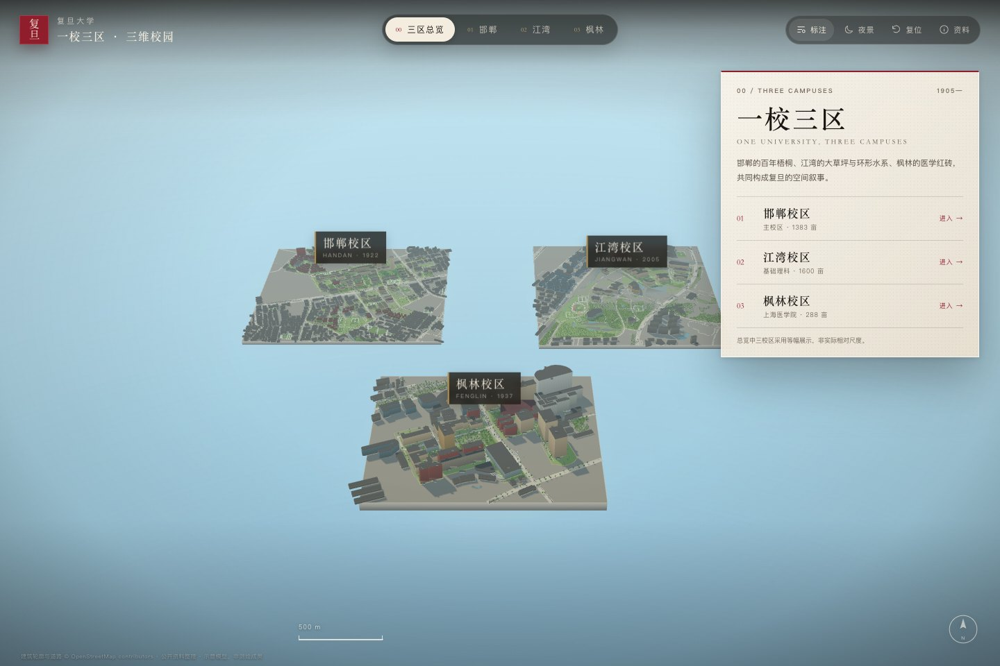
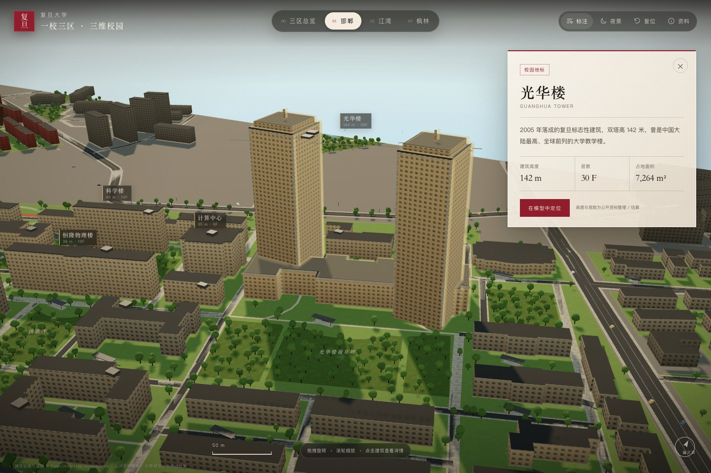
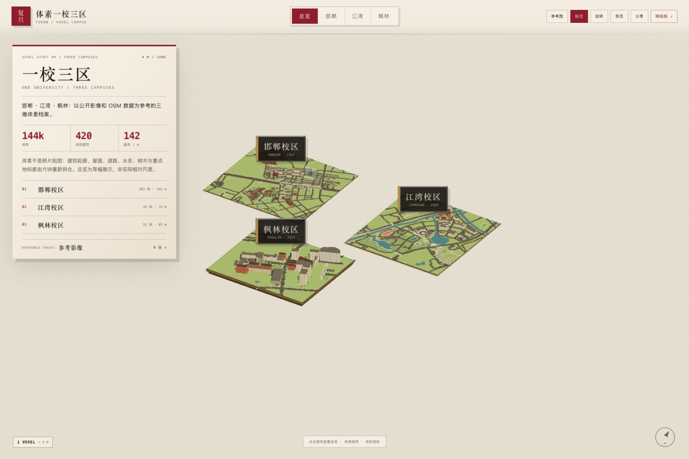
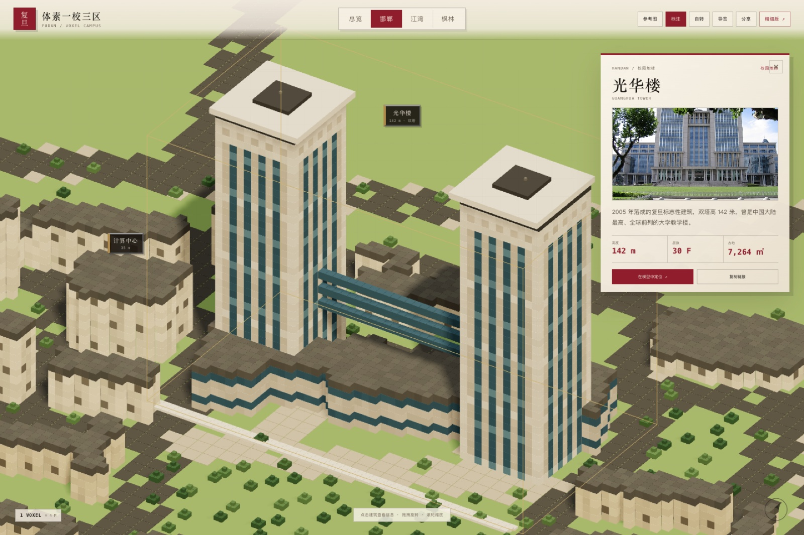
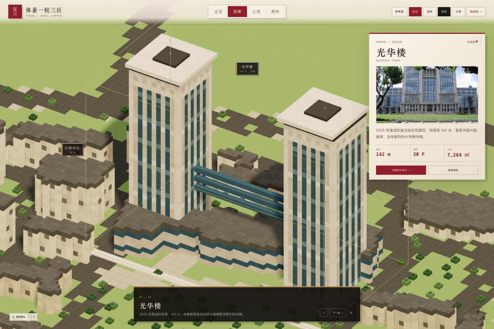
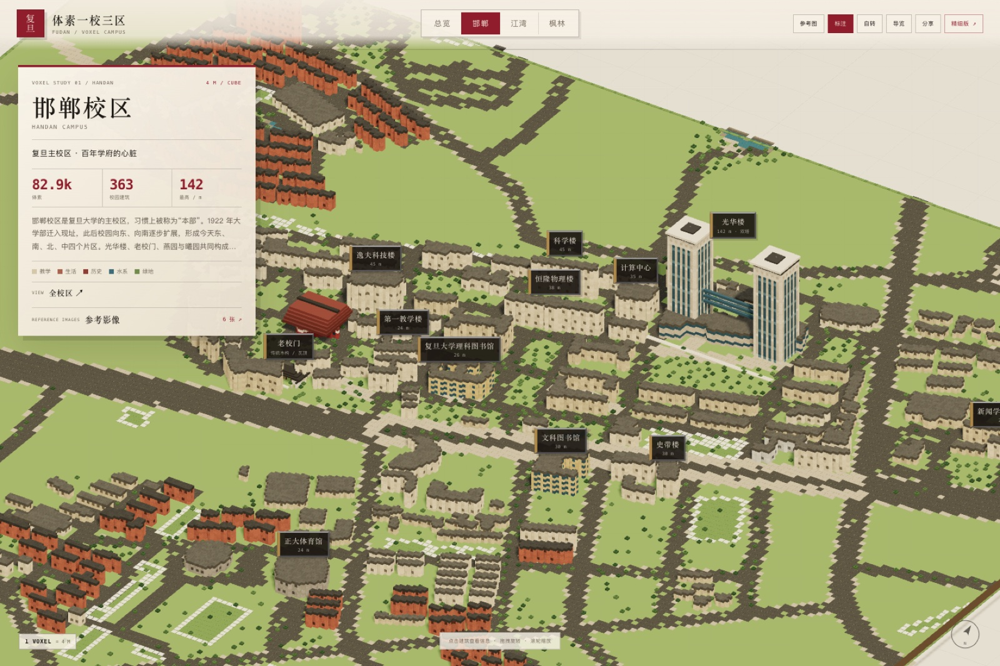
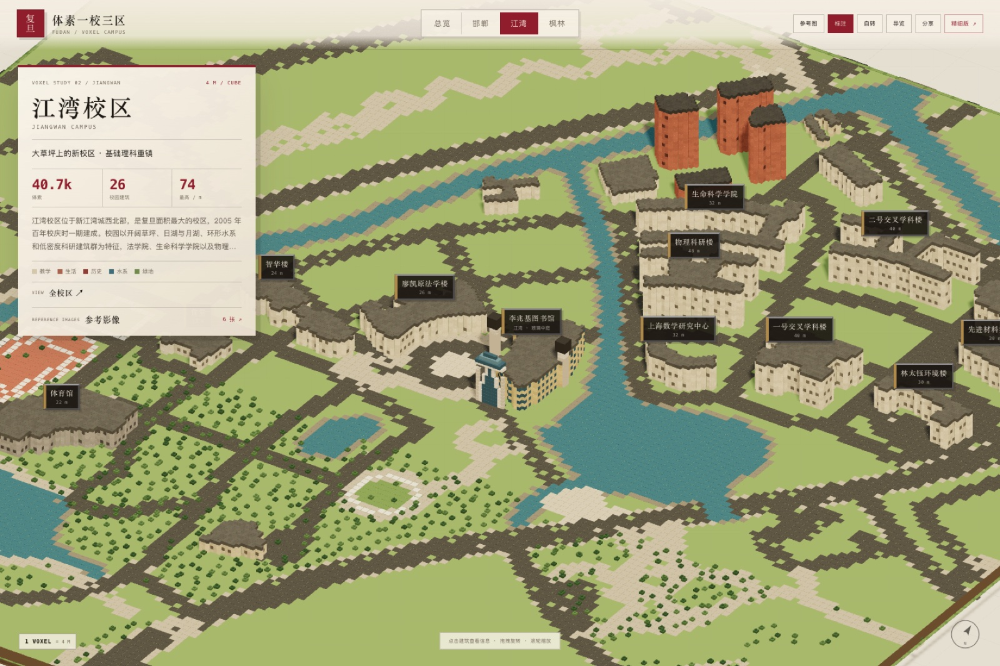
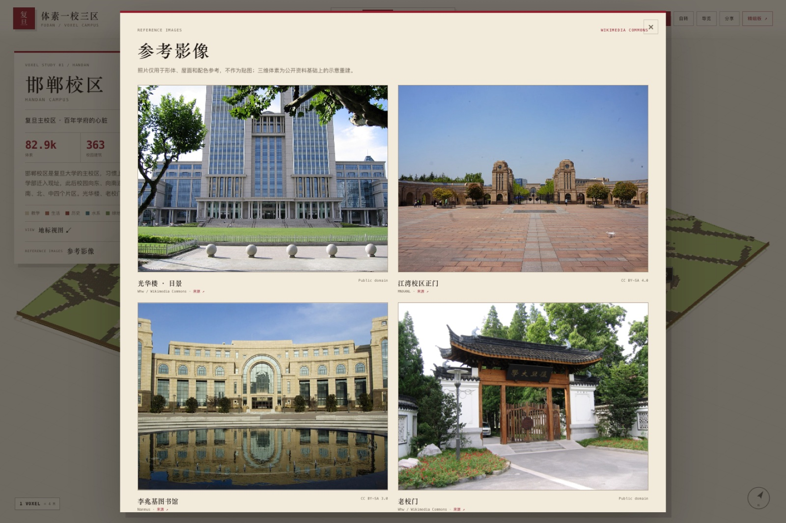
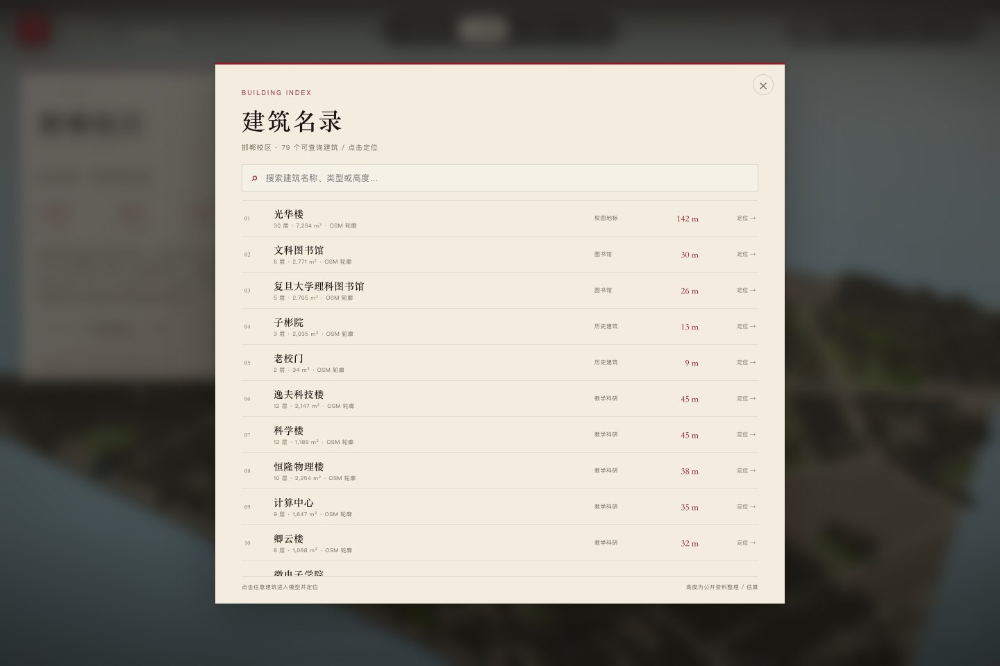

# 复旦大学 · 一校三区｜三维校园与 3D 体素

以公开地理数据、校园资料和公开照片为参考，构建 **邯郸、江湾、枫林** 三校区三维示意模型。
提供两套可交互网页：**精细体块版**与 **3D 体素版**，并附带可导入 Blender / SketchUp / 其他三维软件的 GLB 模型。







## 立即浏览

网页使用 ES Module 和本地数据，需要通过 HTTP 打开（不能直接双击 `index.html`）：

```bash
cd 复旦大学
python3 -m http.server 8765
```

浏览器打开：

- **精细体块版**：<http://127.0.0.1:8765/>
- **3D 体素版**：<http://127.0.0.1:8765/voxel.html>

如端口被占用，可换成 `8000` 或其他端口。

## 交互

- **拖拽**旋转，**滚轮 / 双指**缩放，**右键 / 双指拖动**平移
- 顶部切换 **三区总览 / 邯郸 / 江湾 / 枫林**
- 点击建筑查看名称、高度、层数、占地与简介；双击或使用详情面板中的“在模型中定位”聚焦
- **建筑名录**：按名称 / 类型 / 高度搜索三校区主要建筑，点击直接定位（邯郸 79、江湾 21、枫林 28 个可查询条目）
- 细节层：入口雨棚、门厅、台阶、石材基座 / 檐口、宿舍阳台、屋顶设备、人行道 / 路缘 / 道路中心线、运动场标线、水系驳岸、绿篱、路灯与停放车辆
- **标注**：显示 / 隐藏建筑、园林、水系与道路标注
- **夜景**：切换日景 / 夜景（建筑窗光、月光与深色天空）
- **复位**：回到当前校区默认视角
- **资料**：查看数据来源、建模说明和免责声明
- 校区卡片右上角 `−` 可收起简介；左上角“复旦”印章可回到三区总览
- 键盘：`0` 总览，`1/2/3` 切换校区，`N` 夜景，`L` 标注，`R` 复位，`Esc` 关闭面板

## 3D 体素版

**<http://127.0.0.1:8765/voxel.html>**，也可从精细版右上角的 ▦「体素」按钮进入。

体素版不是把照片贴到方块上，而是把校园重新栅格化：

- **4 m 体素网格**：三校区共约 **14.4 万个方块**，约 173 万三角面
- **重点地标手工拼合**：光华楼双塔、老校门、李兆基图书馆、东一号楼、江湾图书馆玻璃中庭
- **场地体素化**：分层悬浮底座、块状道路 / 人行道 / 水系 / 运动场 / 树木 / 校园核心区
- **参考影像**：页面内「参考图」收录 6 张 Wikimedia Commons 照片，用于形体、屋面与配色参考；照片不作为贴图使用
- **交互**：点击建筑查看照片、高度、层数、占地与简介；4 站地标导览；全校区 / 地标视图切换；自动旋转；分享当前视角
- **可分享**：切换校区、选中建筑会写入 URL，复制链接即可回到同一视角
- **GLB**：体素模型以合并方块导出，不依赖 `EXT_mesh_gpu_instancing`，可在更多三维软件中直接打开












## 三校区

| 校区 | 公开面积 | 模型内校园建筑 | 最高体块 | 时间 |
| --- | ---: | ---: | ---: | --- |
| 邯郸 Handan | 约 1383 亩 | 363 栋 | 光华楼 142 m | 1922 年迁入现址 |
| 江湾 Jiangwan | 约 1600 亩 | 26 栋 | 约 74 m | 2005 年启用 |
| 枫林 Fenglin | 约 288 亩 | 31 栋 | 约 85 m | 1937 年启用 |

> “模型内校园建筑”指落在本次建模校园边界内、且被单独建模的 OSM 建筑轮廓数量，**不是**学校全部建筑总量。边界外仍有大量周边城市建筑以灰色背景体块呈现，未计入该数字。

### 邯郸

主校区，习惯称“本部”。模型保留了光华楼双塔、老校门、理科 / 文科图书馆、子彬院、正大体育馆、燕园、曦园、光华楼前草坪等主要节点。

### 江湾

以日湖、月湖、环形水系、大草坪和低密度科研建筑群为特征。模型重点呈现李兆基图书馆、廖凯原法学楼、生命科学学院、物理 / 化学 / 环境 / 材料楼、交叉学科楼、智华楼、上海数学中心与体育馆。

### 枫林

原上海医科大学校址，由东安路分为东苑、西苑。模型呈现东一号楼历史建筑、明道楼、治道楼、复星楼、康泉图书馆、二号医学科研楼、综合体育馆，以及相邻的中山医院体块。



## 参考影像

体素版使用的 6 张参考照片来自 Wikimedia Commons，仅用于形体、屋面、材质与配色参考，**不作为三维贴图**。页面内可打开「参考图」查看大图与作者信息。

| 参考对象 | 文件 | 作者 | 许可 | 来源 |
| --- | --- | --- | --- | --- |
| 光华楼 · 日景 | `references/ref_0.jpg` | Whw | Public domain | [Commons](https://commons.wikimedia.org/wiki/File:Fudan-guanghualou2.jpg) |
| 光华楼 · 暮色 | `references/ref_1.jpg` | 谢宇杰 | CC BY-SA 4.0 | [Commons](https://commons.wikimedia.org/wiki/File:Guanghua_Tower_of_Fudan_University.jpg) |
| 江湾校区正门 | `references/ref_2.jpg` | MNXANL | CC BY-SA 4.0 | [Commons](https://commons.wikimedia.org/wiki/File:201704_Gate_of_Fudan_University_Jiangwan_Campus.jpg) |
| 李兆基图书馆 | `references/ref_4.jpg` | Nanmus | CC BY-SA 3.0 | [Commons](https://commons.wikimedia.org/wiki/File:Fudan_Jiangwan_Library.png) |
| 枫林 · 公共卫生学院 | `references/ref_5.jpg` | 邵强 | CC BY-SA 4.0 | [Commons](https://commons.wikimedia.org/wiki/File:School_of_Public_Health,_Fudan_University.jpg) |
| 老校门 | `references/ref_7.jpg` | Whw | Public domain | [Commons](https://commons.wikimedia.org/wiki/File:Fudan-building3.jpg) |

> 参考照片的著作权归原作者；CC BY-SA 图片在再分发时需保留作者、许可与来源。完整元数据见 `references/credits.json`。

## GLB 模型

位于 `models/`：

| 文件 | 内容 | 大小 |
| --- | --- | ---: |
| `fudan-three-campuses.glb` | 三校区合并总览，共用展台，仅保留校区铭牌 | 55.7 MB |
| `fudan-handan.glb` | 邯郸校区单体，含 8 个重点建筑标注 | 31.0 MB |
| `fudan-jiangwan.glb` | 江湾校区单体，含重点建筑标注 | 24.1 MB |
| `fudan-fenglin.glb` | 枫林校区单体，含重点建筑标注 | 11.2 MB |

- 坐标：**Y 轴向上，单位米**；校区内部的东 / 南方向与真实地理方向一致
- 材质：PBR 金属 / 粗糙度、程序化立面与地面纹理、水系法线、树冠顶点色
- 纹理与标注均已嵌入 GLB，不依赖外部图片
- 合并模型按真实米制尺度并置，三校区之间的间距为展示需要，不代表真实相对位置
- 单体和合并模型均带简单方向光；不同查看器的默认曝光可能不同

本地快速预览：

```text
http://127.0.0.1:8765/glb_view.html?m=./models/fudan-three-campuses.glb
```

或：

```text
http://127.0.0.1:8765/glb_view.html?m=./models/fudan-handan.glb
```

### 体素版 GLB

| 文件 | 内容 | 大小 |
| --- | --- | ---: |
| `fudan-voxel-three-campuses.glb` | 三校区体素合并场景 | 74.1 MB |
| `fudan-voxel-handan.glb` | 邯郸体素单体 | 42.6 MB |
| `fudan-voxel-jiangwan.glb` | 江湾体素单体 | 20.9 MB |
| `fudan-voxel-fenglin.glb` | 枫林体素单体 | 10.6 MB |

- 每个方块都烘焙成合并网格，不依赖实例化扩展；坐标 Y 轴向上，单位米
- 重点建筑标签以透明贴图平面嵌入；无外部纹理依赖
- 体素模型保留 4 m 栅格和高低错落的方块边缘，便于在 Blender / SketchUp 中继续编辑
- 预览：`http://127.0.0.1:8765/glb_view.html?m=./models/fudan-voxel-three-campuses.glb`

## 在线部署

项目是**纯静态站点**，根目录即可直接部署，不需要构建步骤。`index.html`、`voxel.html`、`vendor/`、`data/campuses.json`、`references/` 和 `models/` 之间全部使用相对路径。

### GitHub Pages

1. 将仓库推送到 GitHub；
2. Settings → Pages → Source 选择 `Deploy from a branch`，分支 `main`，目录 `/ (root)`；
3. 站点会发布到 `https://<用户名>.github.io/<仓库名>/`。

`.nojekyll` 已包含，避免 Jekyll 忽略静态目录。模型文件较大，GitHub 单文件上限 100 MB；本项目的最大 GLB 为 74 MB，仍在限制内。若仓库有流量或体积要求，可把 `models/` 放入 Git LFS 或对象存储，并同步修改 README 中的链接。

### Netlify

- 直接把项目根目录拖到 Netlify Drop；或连接仓库，`netlify.toml` 已设置 `publish = "."`；
- GLB 使用长缓存，`references/` 使用一周缓存。

### Vercel

```bash
npx vercel --prod
```

`vercel.json` 已包含模型和 vendor 的缓存头。Vercel 单文件限制通常为 100 MB，合并体素 GLB 76 MB 可上传。

### Cloudflare Pages

Cloudflare Pages 对单文件有较小限制（约 25 MiB），本项目 74 MB 的合并 GLB 不适合直接上传；可只部署网页和单校区 GLB，或把大模型放到 R2 / 对象存储。

### 部署检查清单

- `index.html` 与 `voxel.html` 能直接通过 HTTPS 打开
- `data/campuses.json`、`vendor/`、`references/` 均返回 200
- 大 GLB 的 `Content-Type` 为 `model/gltf-binary`（配置已给出）
- 分享 URL 形如 `?campus=handan&b=光华楼`

## 数据来源

- **OpenStreetMap contributors**：建筑轮廓、道路、步行道、水系、绿地、运动场地、部分层数 / 高度标签。  
  许可：ODbL 1.0 · <https://www.openstreetmap.org/copyright>  
  数据快照：2026-10-18，经 Overpass API 获取。
- **复旦大学**：校区概况、历史与院系信息。  
  <https://www.fudan.edu.cn/>
- **复旦大学上海医学院**：枫林校区与上医历史。  
  <https://www.shmu.edu.cn/>
- **复旦大学枫林校区管委会**：<https://fenglin.fudan.edu.cn/>
- **维基百科**（CC BY-SA 4.0）：校区面积、历史沿革、建筑背景。  
  - 邯郸校区：<https://zh.wikipedia.org/wiki/复旦大学邯郸校区>  
  - 江湾校区：<https://zh.wikipedia.org/wiki/复旦大学江湾校区>  
  - 枫林校区：<https://zh.wikipedia.org/wiki/复旦大学枫林校区>  
  - 光华楼：<https://zh.wikipedia.org/wiki/光华楼>
- **复旦大学图书馆**：江湾李兆基图书馆介绍。  
  <https://library.fudan.edu.cn/cd/c3/c42878a708035/page.htm>

## 建模方法

1. 从 OSM 提取三校区边界、建筑、道路、水系、绿地、运动场等要素。
2. 对边界做裁切、合并与简化；邯郸校区的多块 OSM 多边形被合并为一个连续展示底座，枫林校区合并东苑、西苑。
3. 以校区局部切平面投影为米制坐标：`x` 向东，`z` 向南，`y` 向上。
4. 建筑按轮廓拉伸；优先使用 OSM 的 `height` / `building:levels`，缺失时按建筑类型、面积和公开资料推定。
5. 光华楼按“裙房 + 双塔”重建，并增加石材转角、裙房檐口与屋顶构件；老校门重建为石构拱门 + 瓦屋顶；东一号楼、子彬院等历史建筑使用带正脊的坡屋顶与瓦面纹理。
6. 建筑细节层包含石材基座、檐口、入口雨棚 / 门厅 / 台阶、宿舍阳台、屋顶设备与绿篱；道路增加人行道、路缘和中心线，运动场增加跑道 / 球场标线，水系增加驳岸，并布置路灯与停放车辆。
7. 树木按绿地与道路分布程序化布点；树冠、地面、立面、石材与瓦面纹理由 Canvas 程序生成。
8. 水面使用法线贴图和环境反射；夜景通过发光窗贴图、月光、路灯与换色天空实现。
9. Three.js 导出的 GLB 中，InstancedMesh 树木被烘焙为普通网格，便于更多软件导入；GLB 中树木为低模版本以控制文件体积。
10. 体素版以 **4 m** 为基本单元重新栅格化建筑、道路、水系、树木和地形；建筑采用空心外壳 + 满铺屋面，避免不可见的内部方块。
11. 光华楼、老校门、李兆基图书馆、东一号楼等按公开照片的轮廓、色彩与屋顶特征手工拼合；参考照片不作为贴图。
12. 体素 GLB 将每个方块烘焙为合并网格（不依赖实例化扩展），并嵌入重点建筑标签。

### 高度与细节说明

- **光华楼**：142 m，双塔 30 层，依据公开资料。
- 江湾、枫林多数建筑的 OSM 层数缺失，高度为公开资料与体量比例推定。
- 立面窗格、屋顶设备、树木、铺装与灯光为程序化表达。
- 校园边界来自 OSM，部分边界与学校官方红线可能存在差异；江湾生活园区、枫林护理学院等不相连地块未单独展开。

**本模型是公开资料整理与示意性重建，不是测绘成果，不可用于工程、导航、边界认定或消防疏散。**

## 重建流程

### 1. 生成校区数据

```bash
python3 -m venv .venv
.venv/bin/pip install shapely
.venv/bin/python scripts/build_data.py
```

输入为 `data/raw/` 中的 OSM 快照，输出 `data/campuses.json`。

### 2. 导出 GLB

```bash
pnpm install
node scripts/export_glb.mjs
node scripts/export_voxel_glb.mjs
```

依赖：`three`、`@napi-rs/canvas`（用于 Node 端文字/纹理烘焙）。体素版读取同一份 `data/campuses.json`，不额外依赖 GIS 库。

### 3. 本地预览

```bash
python3 -m http.server 8765
```

## 文件结构

```text
.
├── index.html                  # 精细体块版主网页
├── styles.css                  # 精细版样式
├── voxel.html                  # 3D 体素版网页
├── voxel.css                   # 体素版样式
├── src/
│   ├── main.js                 # 精细版场景 / 交互 / 昼夜
│   ├── campusScene.js          # 精细版校区组装
│   ├── geometry.js             # 拉伸体块、道路、树木几何
│   ├── textures.js             # 程序化立面 / 地面 / 水纹
│   ├── labels.js               # 精细版 DOM 标注层
│   └── voxel/
│       ├── main.js             # 体素版场景 / 相机 / UI
│       ├── voxelWorld.js       # OSM 数据 → 体素方块
│       └── voxelScene.js       # 体素底座 / 实例化 / 合并网格
├── vendor/                     # 本地 Three.js 与 OrbitControls 等
├── data/
│   ├── campuses.json           # 网页使用的基础数据
│   └── raw/                    # OSM 原始快照（可追溯）
├── references/                 # Wikimedia 参考照片与 credits.json
├── models/                     # 8 个 GLB（精细 4 + 体素 4）
├── glb_view.html               # GLB 预览页
├── screenshots/                # 项目预览图
├── scripts/
│   ├── build_data.py           # OSM → campuses.json
│   ├── export_glb.mjs          # 精细版 Three.js 场景 → GLB
│   └── export_voxel_glb.mjs    # 体素合并网格 → GLB
└── README.md
```

## 已知限制

- 单体建筑窗户、屋顶设备和树木分布为程序化结果，不对应真实窗户 / 设备位置。
- 邯郸校区 OSM 边界包含 13 个离散多边形，已合并为连续底座；周边道路与建筑仍按 OSM 呈现。
- 江湾校区模型以教学科研核心区为主，生活园区在边界外，未纳入“校园建筑”统计。
- 枫林校区东苑、西苑按 OSM 与公开资料合并；中山医院作为相邻医疗体块呈现。
- 精细版 GLB 合并模型约 56 MB；体素版合并 GLB 约 74 MB，移动端或低配置设备加载可能较慢。
- 体素版受 4 m 网格限制，窗格、门洞、栏杆等小于 4 m 的构件被概括；重点地标为手工解释性重建。
- 体素版重点建筑标签为透明平面，不是三维文字；在部分视角可能被建筑遮挡。
- 建筑名录中的“可查询”仅包含有名称、且非纯编号宿舍的建筑；完整体块数量以校区统计为准。
- 夜景窗光为统一程序化模式，并非真实入住率。

## 许可与署名

- 地理几何数据衍生于 **OpenStreetMap**，按 **ODbL 1.0** 提供；再分发或公开使用请保留  
  “© OpenStreetMap contributors, ODbL 1.0” 署名。
- 校区历史、面积和建筑背景参考复旦大学公开资料及维基百科（CC BY-SA 4.0）。
- 本项目未使用复旦大学官方校徽；页面中的“复旦”印章为文字化视觉元素。
- `references/` 中的参考照片来自 Wikimedia Commons，许可见 `references/credits.json`（Public domain / CC BY-SA 3.0 / CC BY-SA 4.0）；仅作形体与配色参考。
- 代码与视觉设计可用于学习、研究和展示；第三方数据仍遵循其各自许可。

---

模型生成：2026-10 · Three.js · OpenStreetMap
